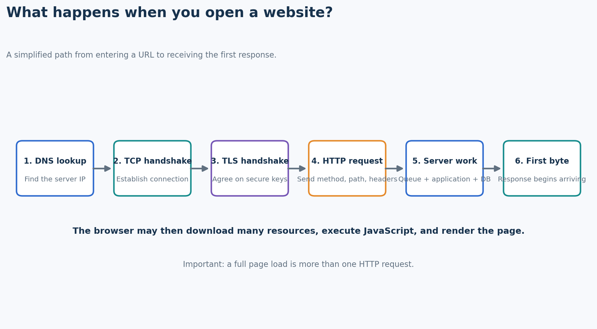
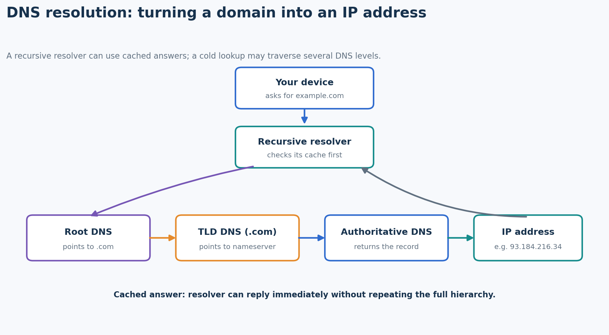
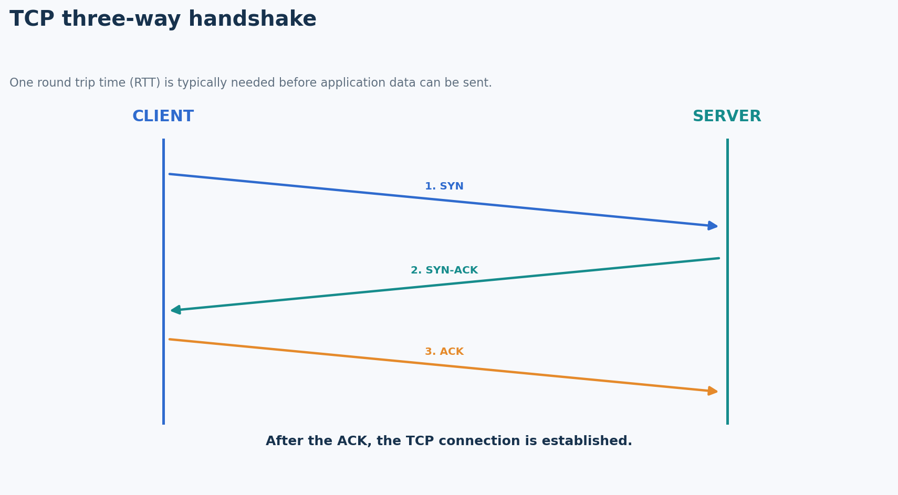
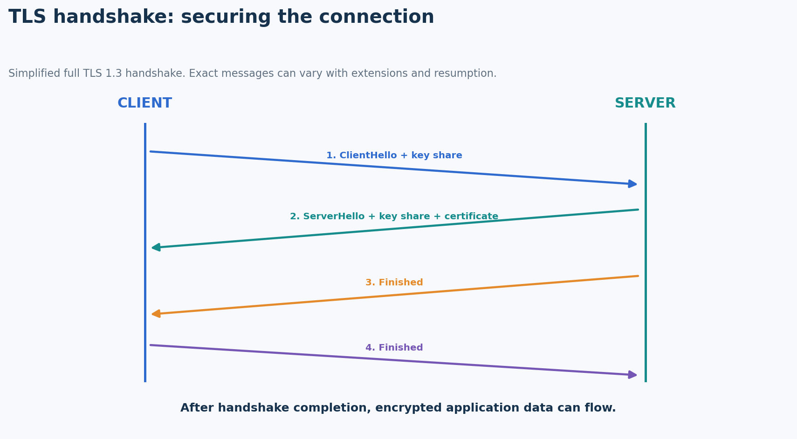
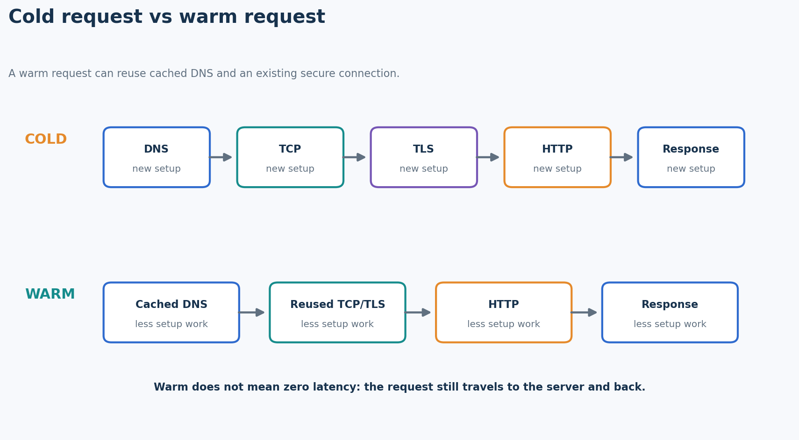

# AI System Design Ep. 1: Networking & Latency Basics

**Source:** *AI System Design Ep. 1: Networking & Latency Basics* — Think in Models

These notes explain what happens between a client requesting a resource and receiving a response, why latency varies, and how to reason about performance bottlenecks in system-design interviews.

## 1. Latency, throughput, and RTT

- **Latency** is the time taken for an operation or request to complete.
- **Throughput** is how much work or how many requests a system can handle per unit of time.
- **RTT (round-trip time)** is the time for a signal to travel from the client to a server and for a response to return.

A system can have high throughput but still have high latency. For example, a service may process thousands of requests per second while an individual request waits in a queue.

Distance matters: data travelling through fiber is limited by the speed of light in the medium. The physical distance between a user and a server creates a latency floor that software optimizations cannot completely remove.

## 2. What happens when you open a website?

A simplified sequence is:

1. DNS resolves the domain name to an IP address.
2. TCP establishes a transport connection.
3. TLS establishes encryption for HTTPS.
4. The client sends an HTTP request.
5. The server performs work, possibly including queueing, application logic, and database calls.
6. The first response byte returns to the client.

A real browser page load can involve many requests for HTML, CSS, JavaScript, images, fonts, and API data. It also includes JavaScript execution and rendering, so a page load is not the same as one HTTP request.

## 3. DNS resolution

DNS (Domain Name System) translates a human-readable domain such as `example.com` into an IP address.

A typical lookup can involve:
- **Stub resolver:** the client's operating-system or browser-side resolver.
- **Recursive resolver:** performs lookup work on the client's behalf and checks its cache.
- **Root DNS server:** directs the resolver toward the relevant top-level domain.
- **TLD server:** for example, `.com`; points toward the domain's authoritative nameserver.
- **Authoritative nameserver:** provides the DNS record for the domain.

**Caching matters:** if a valid answer is cached, the resolver may return it without repeating the hierarchy. An uncached lookup can involve multiple network exchanges, but DNS does not always take a fixed number of RTTs.

## 4. TCP three-way handshake

TCP is a connection-oriented transport protocol. Before normal application data is exchanged, the client and server establish connection state.

1. **SYN:** client asks to start a connection.
2. **SYN-ACK:** server acknowledges and responds with its own SYN.
3. **ACK:** client acknowledges the server.

This typically costs **one RTT** before application data can be sent.

## 5. TLS handshake: TLS 1.2 vs TLS 1.3

TLS (Transport Layer Security) protects data in transit by providing encryption and authentication.

For a typical full handshake:
- **TLS 1.2:** commonly requires 2 RTTs before application data.
- **TLS 1.3:** commonly requires 1 RTT before application data.

The exact flow can differ with session resumption and other protocol features. TLS 1.3 reduces handshake latency compared with a typical full TLS 1.2 handshake.

## 6. Cold request vs warm request

A **cold request** may need DNS resolution, a new TCP connection, and a new TLS handshake.

A **warm request** may benefit from:
- DNS cache
- Reuse of an existing TCP connection (keep-alive / connection pooling)
- Reuse of an existing TLS connection, or TLS session resumption for a new connection

These are separate mechanisms. A warm request still has network transit, server processing, and response transfer time.

## 7. Understanding TTFB

**TTFB (Time to First Byte)** measures the time from initiating a request until the first byte of the response is received.

It can include:
- Request network transit
- Server-side queueing
- Application processing
- Database or downstream-service work
- Response network transit until the first byte arrives

Therefore, TTFB is **not** a direct measurement of application execution time alone.

The chart is illustrative, not a universal latency profile. Real timings depend on geography, network conditions, connection reuse, server load, and payload.

## 8. TCP slow start

TCP congestion control limits how much unacknowledged data a sender can have in flight. At the start of a connection, TCP uses a congestion window (`cwnd`) and increases it as acknowledgements arrive during slow start.

In the slow-start phase, the congestion window can grow rapidly (often roughly exponentially per RTT), until a threshold or congestion signal changes the growth behavior. Exact behavior depends on the TCP implementation and network conditions.

This is one reason a new connection can behave differently from an established connection, especially when transferring a large response.

## 9. Common latency optimizations

| Optimization | What it helps with |
|---|---|
| CDN / edge delivery | Serves content closer to users and reduces long-distance trips |
| Connection reuse | Avoids repeating TCP and TLS setup for each request |
| TLS 1.3 | Reduces typical full-handshake round trips compared with TLS 1.2 |
| Compression | Reduces bytes transferred, especially for text assets |
| Caching | Avoids repeated computation or network lookups |
| Payload reduction | Reduces transfer time and sometimes processing time |

No single optimization fixes every bottleneck. Measure first, then target the dominant cost.

## 10. How to debug a slow request in an interview

Use this repeatable framework:

1. **Decompose:** break total time into DNS, connection setup, TLS, request transit, server work, and response transfer.
2. **Measure:** collect timings at the client, network, load balancer, application, and downstream services.
3. **Find the dominant component:** identify which phase explains most of the delay.
4. **Optimize and remeasure:** change one relevant thing, then verify whether end-to-end latency improved.

Useful clues:
- Only the first request is slow → investigate DNS, TCP/TLS setup, and cold caches.
- Users far from the server are slow → investigate geography, CDN, and edge placement.
- TTFB is high across regions → investigate server queueing, application work, and downstream dependencies.
- Large responses are slow → investigate payload size, compression, bandwidth, and congestion.
- Many users are slow at once → investigate service saturation, queues, databases, and shared dependencies.

## 11. Numerical example: latency budget

Suppose an illustrative request has:

| Phase | Time |
|---|---:|
| DNS | 400 ms |
| TCP handshake | 300 ms |
| TLS handshake | 200 ms |
| Server processing | 40 ms |
| Transfer | 300 ms |
| **Total** | **1,240 ms** |

The total is 1,240 ms (not 1,140 ms). These are hypothetical values for practicing latency decomposition, not a universal timing model.

## 12. Interview-ready explanation

“When a client requests a website, the browser may first resolve the domain through DNS. It then establishes a TCP connection and, for HTTPS, performs a TLS handshake. After that it sends the HTTP request. The server may queue the request, execute application logic, and call databases or other services before returning a response. End-to-end latency therefore includes more than backend execution time: it also includes DNS, connection setup, network round trips, queueing, and data transfer. I would measure each phase, find the dominant bottleneck, optimize that part, and remeasure.”

## 13. Important connection to the Python HTTP timing analyzer

When interpreting timings from a small Python network analyzer:

- A timer around `socket.sendall()` measures the local send operation; it does **not** measure the complete trip to the server.
- TTFB includes network transit and server-side delay before the first byte arrives.
- If download timing starts after the first response chunk is read, that measurement excludes the first chunk.
- Measure total wall-clock duration independently with a timer around the complete operation. Avoid assuming that independently reported phase values always add up cleanly if their measurement windows overlap.

---

**Key idea:** End-to-end latency is a sum of multiple costs. Good system design starts by identifying which cost dominates for the user, rather than assuming the backend code is always the problem.
