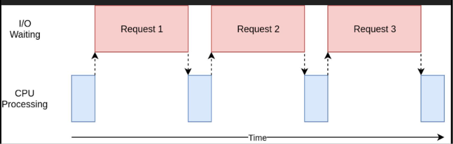
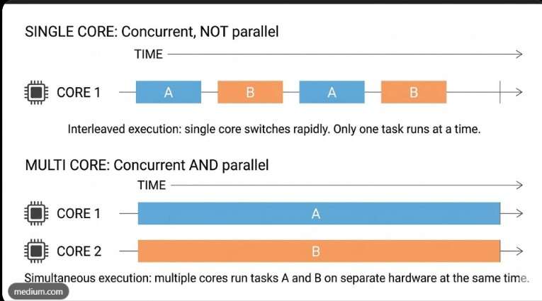
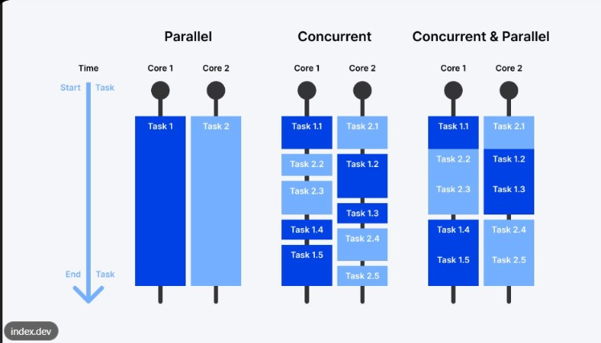
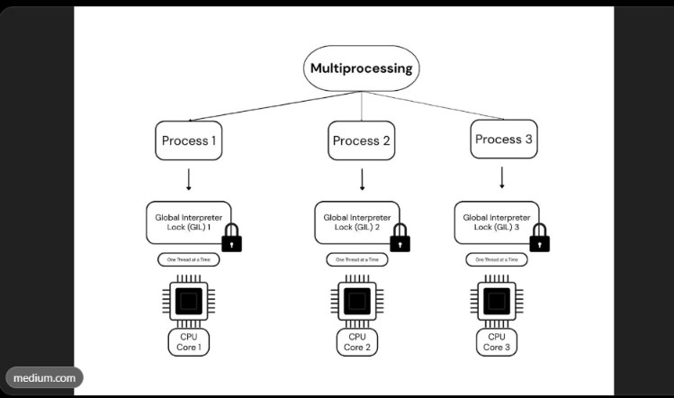

# AI System Design – Episode 2
## Concurrency and Parallelism Demystified

*System Design Notes · Interview Preparation*

---

## 1. The Real-World Problem: Why Did the AI Chatbot Crash?

Imagine a company develops an AI chatbot.

For an entire year, the chatbot works perfectly:

- Handles 10,000+ open user connections.
- CPU utilization stays very low.
- Users can send messages and receive responses without problems.

The company then introduces a new feature: **Image Upload and Processing**.

Users can now upload images and ask questions about them.

Before sending an image to the AI model, the application performs some preprocessing:

1. Resize the image.
2. Adjust image contrast.
3. Normalize pixel values.
4. Prepare the image for the AI model.

However, something unexpected happens.

| | Before image processing | After image processing |
|---|---|---|
| Load | 10,000+ chat connections | Only 100 image uploads |
| System state | Healthy | Overloaded |
| CPU usage | Near idle | 100% |

**The important question:**

> Why could the application handle 10,000 chat connections but crash with just 100 image uploads?

The answer lies in understanding two types of workloads:

- I/O-bound tasks
- CPU-bound tasks

---

## 2. I/O-Bound vs CPU-Bound Tasks

This is one of the most important distinctions in backend system design.

### A. I/O-bound tasks

I/O stands for Input/Output.

An I/O-bound task spends most of its time **waiting** for something external to complete.

**Examples:**

- Waiting for a user to type a message.
- Waiting for an API response.
- Reading data from a database.
- Downloading a file.
- Receiving data over a network.

**Example: AI chatbot**

Suppose a user sends a message to an AI chatbot. The application might:

1. Receive the user's message.
2. Send a request to an external AI API.
3. Wait for the API to generate a response.
4. Receive the response.
5. Send the response back to the user.

During step 3, the application is mostly waiting for the external API. The CPU does not need to continuously perform calculations during this waiting period.

> **Key takeaway:** I/O-bound tasks spend more time waiting than computing.

### B. CPU-bound tasks

A CPU-bound task spends most of its time **performing calculations**.

**Examples:**

- Image resizing and processing.
- Video encoding.
- Machine learning computations.
- Mathematical calculations.
- Compression and encryption.
- Processing large datasets.

**Example: Image preprocessing**

Suppose a user uploads a 20 MB image. The application needs to:

1. Read image pixels.
2. Calculate new pixel values.
3. Resize the image.
4. Adjust contrast.
5. Normalize the image.

These operations require substantial computation. The CPU continuously works on these calculations rather than waiting for an external response.

> **Key takeaway:** CPU-bound tasks spend more time computing than waiting.

### C. Comparison

| I/O-bound | CPU-bound |
|---|---|
| Mostly waiting | Mostly computing |
| Network requests | Image processing |
| Database queries | Video encoding |
| File downloads | Mathematical calculations |
| API calls | Large data transformations |
| CPU often idle while waiting | CPU heavily utilized |

**Interview question:** How do you identify whether a task is I/O-bound or CPU-bound?

Look at what limits its execution time:

- If it is waiting for external resources, it is **I/O-bound**.
- If it is spending time executing calculations, it is **CPU-bound**.

---

## 3. Understanding the Restaurant Analogy

Now let's understand the different execution models using a restaurant.

Imagine a restaurant with:

- 5 tables.
- 5 customers.
- Each customer needs to place an order.
- The waiter must serve all five tables.

The way the restaurant manages its waiters represents different software execution models.

### A. Multithreading – One waiter per table

Imagine hiring five waiters. Each waiter is assigned one table.

**How does this work?**

- Waiter 1 serves Table 1.
- Waiter 2 serves Table 2.
- Waiter 3 serves Table 3.
- Waiter 4 serves Table 4.
- Waiter 5 serves Table 5.

In programming, each waiter represents a **thread**.

> A thread is an independent sequence of execution within a process.

**The problem:**

Suppose all five customers place their orders and then start reading the menu. All five waiters are now waiting. They cannot efficiently use their time to serve other tables because each waiter is dedicated to one customer.

In a server, creating thousands of threads for thousands of connections can introduce:

- Memory overhead.
- Operating system scheduling overhead.
- Context-switching overhead.

This is why creating one thread per connection is not always efficient.

### B. AsyncIO – One waiter managed by an event loop

Now imagine hiring just one waiter and introducing a restaurant manager.

The waiter starts serving Table 1. The customer starts reading the menu. Instead of standing idle, the waiter tells the manager:

> "Table 1 is reading the menu. I'll come back when they are ready."

The waiter moves to Table 2. The same process continues.

This is how asynchronous programming works:

- The **waiter** represents a single thread.
- The **manager** represents the event loop.
- The **tables** represent different tasks.

The event loop keeps track of tasks and schedules them when they are ready to make progress.

**What is an Event Loop?**

An event loop is a mechanism that continuously checks which asynchronous tasks are ready to execute and runs them.

For example:

1. Task A sends an API request.
2. Task A waits for the response.
3. The event loop switches to Task B.
4. Task B reads from a database.
5. Task B waits for the result.
6. The event loop switches to Task C.
7. When Task A receives its response, the event loop resumes it.

This allows one thread to manage many I/O-bound tasks efficiently.

**How AsyncIO actually executes tasks**

One thread handling three tasks (illustrative execution timeline):

| Task | Work |
|---|---|
| Task A | API request |
| Task B | Database |
| Task C | Network |

1. Execute Task A until it reaches an `await` point.
2. Task A waits for the API response. Execute Task B.
3. Task B waits for the database. Execute Task C.
4. Task A's response arrives. Resume Task A.
5. Continue executing whichever task is ready.

**One thread, multiple overlapping tasks.**

Notice something important: the tasks are not necessarily executing at the exact same time. Instead, the thread switches between tasks whenever they reach a point where they can wait.

This is **concurrency**.

---

## 4. Concurrency vs Parallelism

These two terms are often confused in interviews. Let's understand them carefully.

### A. Concurrency

Concurrency means managing multiple tasks during overlapping periods of time. Tasks make progress by taking turns. They do not necessarily execute simultaneously.

Imagine **one chef preparing three different dishes**:

- Start preparing Dish A.
- Put Dish A aside while waiting for something.
- Start Dish B.
- Switch to Dish C.
- Return to Dish A.

The chef manages multiple tasks by switching between them. This is concurrency.

> **Important:** A single CPU core can handle multiple concurrent tasks through task switching.

### B. Parallelism

Parallelism means executing multiple tasks at the exact same time using multiple processing units.

Imagine a restaurant with **three chefs**:

- Chef 1 prepares Dish A.
- Chef 2 prepares Dish B.
- Chef 3 prepares Dish C.

All three work simultaneously. This is parallelism.

> **Important:** Parallelism requires multiple execution resources, such as multiple CPU cores or processing units.

### C. The difference

- **Concurrency** – One worker switching tasks.
- **Parallelism** – Multiple workers executing simultaneously.

| Concurrency | Parallelism |
|---|---|
| Multiple tasks make progress | Multiple tasks execute simultaneously |
| Tasks can take turns | Tasks run at the same time |
| Possible on one core | Requires multiple execution resources |
| Useful for I/O-bound workloads | Useful for CPU-bound workloads |

**Interview-ready answer:**

> Concurrency is about dealing with multiple tasks at once, while parallelism is about executing multiple tasks at the same time.

---

## 5. The Python GIL (Global Interpreter Lock)

This is particularly important when discussing Python multithreading.

**What is the GIL?**

GIL stands for Global Interpreter Lock. In conventional GIL-enabled CPython builds, it is a mechanism that allows only one thread at a time to execute Python bytecode within a process.

### The restaurant analogy

Imagine five waiters working in a restaurant. However, the restaurant has a strange rule:

> Only the waiter holding a special certificate can perform the actual cooking.

There is only one certificate. Even though five waiters are available, only one can cook at a time. The certificate represents the GIL.

### What happens when we use multithreading in Python?

Suppose we create five threads to calculate prime numbers. All five threads want to execute Python bytecode. But the GIL allows only one thread at a time to execute that bytecode in a GIL-enabled CPython process.

Therefore:

- Thread 1 executes.
- Thread 2 waits for the GIL.
- Thread 3 waits for the GIL.
- Thread 4 waits for the GIL.
- Thread 5 waits for the GIL.

Threads can take turns, but they do not achieve true parallel execution of Python bytecode.

> **Important distinction:** The GIL does not prevent multithreading. It limits parallel execution of Python bytecode in a conventional GIL-enabled CPython process.

Also, many native libraries release the GIL while performing certain operations, and Python has optional free-threaded builds.

---

## 6. Multiprocessing – How Do We Overcome the GIL Limitation?

Now imagine the restaurant opens **four independent kitchens**. Each kitchen has:

- Its own chef.
- Its own cooking equipment.
- Its own certificate.

Now all four chefs can cook simultaneously. This represents **multiprocessing**.

**What is Multiprocessing?**

Multiprocessing means creating multiple independent processes to execute tasks. Each process has its own:

- Python interpreter.
- Memory space.
- GIL in conventional GIL-enabled CPython.

This allows CPU-bound tasks to execute in parallel across multiple CPU cores.

For example, imagine we have four CPU cores. We can create four worker processes. Each worker receives a separate computational task.

| Process | CPU core | Work |
|---|---|---|
| Process 1 | Core 1 | Image 1 |
| Process 2 | Core 2 | Image 2 |
| Process 3 | Core 3 | Image 3 |
| Process 4 | Core 4 | Image 4 |

All four images can be processed simultaneously. This is **true parallelism**.

---

## 7. Multithreading vs AsyncIO vs Multiprocessing

Now that we understand the concepts, let's compare the three execution models.

| Feature | Multithreading | AsyncIO | Multiprocessing |
|---|---|---|---|
| Execution unit | Threads | Coroutines | Processes |
| CPU-bound tasks | Limited by GIL in conventional CPython | Poor fit for blocking CPU work | Excellent |
| I/O-bound tasks | Good | Excellent | Usually unnecessary |
| Memory overhead | Moderate | Low | Higher |
| Parallel CPU execution | Limited by GIL | No, on one event-loop thread | Yes |
| Best use case | Blocking I/O | Large numbers of I/O tasks | Heavy computation |

### When should you use each?

**1. AsyncIO**

Use when you have thousands of concurrent I/O operations.

- AI API calls.
- Database requests.
- Chat connections.
- Network communication.

**2. Multithreading**

Use when you need to handle multiple blocking I/O operations.

- Calling synchronous APIs.
- Downloading multiple files.
- Working with libraries that do not support async.

**3. Multiprocessing**

Use when you have computationally intensive tasks.

- Image processing.
- Video encoding.
- Mathematical calculations.
- CPU-intensive data processing.

---

## 8. Python Benchmark Experiments

The video demonstrates these concepts using **Python 3.11** on a machine with **20 logical CPU cores**. The benchmarks compare execution times for I/O-bound and CPU-bound workloads.

### Experiment 1: I/O-bound workload

The experiment simulates 5,000 tasks that spend time waiting.

| Approach | Execution time |
|---|---|
| Multithreading (256 threads) | ~1.0 second |
| AsyncIO (1 thread) | ~0.1 seconds |

*Reported execution times; lower is better.*

**Why is AsyncIO faster here?**

- It does not need thousands of operating system threads.
- It avoids much of the thread scheduling overhead.
- One event loop efficiently manages waiting tasks.
- It switches to other tasks whenever one task is waiting.

The result in the video is approximately **9–10 times faster**.

### Experiment 2: CPU-bound workload

Now the video runs a prime-number calculation to simulate computationally intensive work.

| Approach | Execution time |
|---|---|
| Serial execution | 2.3 seconds |
| Multithreading (24 threads) | 2.3 seconds |
| AsyncIO | 2.2 seconds |
| Multiprocessing (4 workers) | 0.5 seconds |

*Reported execution times; lower is better.*

**Why didn't multithreading improve performance?**

Because the GIL prevents multiple threads from simultaneously executing Python bytecode in a conventional GIL-enabled CPython process.

**Why didn't AsyncIO improve performance?**

Because CPU-heavy tasks do not spend much time waiting or yielding control to the event loop.

**Why did multiprocessing improve performance?**

Because four independent processes can execute their computational workloads in parallel across multiple CPU cores.

**Video benchmark result:** Multiprocessing achieved approximately **4.59x speedup** compared with serial execution.

> **Note:** These are the video's reported benchmark results, not universal performance guarantees. Actual results depend on hardware, task size, process startup costs, data transfer, and implementation.

---

## 9. Applying These Concepts to AI System Design

Let's return to the original AI chatbot problem. The company needs to support:

1. Thousands of open chat connections.
2. Image uploads.
3. Image preprocessing.
4. AI API requests.
5. Responses to users.

Using one execution model for everything is not necessarily a good architectural decision. Instead, we should select the appropriate execution model for each workload.

### Recommended architecture

**Step 1: User sends a request**

The backend receives a chat message or image upload.

**Step 2: AsyncIO handles incoming connections**

The event loop manages multiple user connections efficiently. It handles:

- Incoming requests.
- Network communication.
- External AI API calls.
- Database operations.

**Step 3: Image preprocessing is offloaded**

When a user uploads an image, the application sends the processing job to a worker system. For example:

- Celery
- Redis-backed job queues
- Multiprocessing worker pools

**Step 4: Workers process images**

Independent worker processes perform CPU-intensive tasks. For example:

- Resizing.
- Contrast adjustment.
- Image normalization.

**Step 5: AI model receives the processed image**

The application sends the processed image to the AI model.

**Step 6: Response is returned**

The user receives the AI-generated response.

### Important architectural lesson

> **Do not perform expensive CPU-bound operations directly on the event-loop thread.**
>
> If you do, the event loop gets blocked and cannot efficiently serve other users.
>
> Instead, offload those operations to dedicated workers.